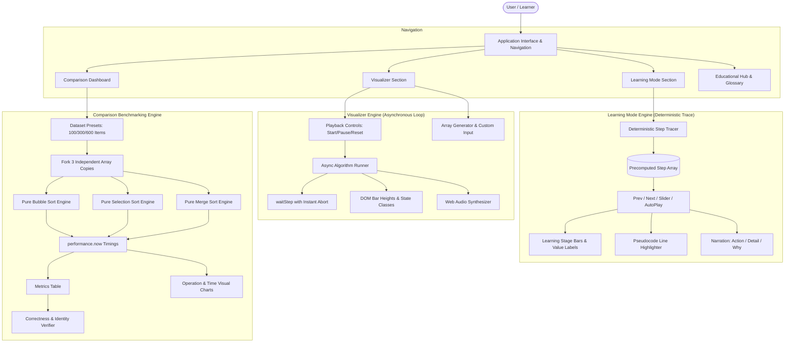

# ACADEMIC PROJECT REPORT

## PROJECT TITLE: SORTING ALGORITHM VISUALIZER & DSA LEARNING SUITE
**Subject**: Data Structures and Algorithms (DSA) / Web Technologies  
**Technology Stack**: HTML5, CSS3, Vanilla JavaScript (ES6+) — Zero External Frameworks or Backend  

---

### ABSTRACT

Sorting algorithms constitute one of the fundamental pillars of computer science, underlying computational efficiency across database queries, compiler design, computer graphics, and operating system scheduling. However, abstract mathematical proofs (e.g., Big-O, Big-Omega, Big-Theta asymptotic bounds) and pseudocode representations can be difficult for students to intuitively grasp when divorced from visual state transitions.

The **Sorting Algorithm Visualizer & DSA Learning Suite** is an interactive, educational web application engineered to bridge the gap between abstract algorithmic theory and runtime execution. Developed purely using modern standard web technologies (HTML5 semantic markup, CSS3 custom properties with grid/flexbox layouts, and asynchronous Vanilla JavaScript ES6+), the system provides four interconnected modules:

1. **Interactive Visualizer**: A dynamic canvas demonstrating atomic array operations with vertical bar animations, playback controls (Start, Pause, Resume, Reset), on-the-fly animation speed throttling (6ms to 420ms delay), custom array input with sanitization, and Web Audio API pitch synthesis.
2. **DSA Learning Mode**: A deterministic step-by-step interactive tutor featuring bidirectional stepping (Previous Step, Next Step, Auto Play, Reset), scrubbable progress bar, and synchronized real-time pseudocode line highlighting paired with pedagogical explanations of comparisons, swaps, position locking, and divide-and-conquer partitions.
3. **Algorithm Comparison Dashboard**: An empirical benchmarking engine that simultaneously executes Bubble Sort, Selection Sort, and Merge Sort on identical independent array copies, measuring actual CPU computation time (`performance.now()`) with zero animation latency, tracking exact comparisons and memory swaps/writes, accompanied by graphical bar charts and automated sorted output verification.
4. **Educational Hub & DSA Glossary**: A comprehensive reference featuring an interactive Complexity Reference Matrix, technical building blocks breakdown (memory layout, comparisons, swaps, recurrence relations), and a complete DSA glossary.

---

### TABLE OF CONTENTS
1. Introduction & Background
2. Problem Statement & Project Objectives
3. Comparative Analysis: Existing vs. Proposed System
4. Hardware & Software Requirements
5. System Architecture & Component Design
6. Module Descriptions & Implementation Mechanics
7. Algorithmic Formulations & Complexity Derivations
8. Testing Methodology & Verification Results
9. Limitations & Future Scope
10. Conclusion & References

---

### CHAPTER 1: INTRODUCTION & BACKGROUND

Data sorting refers to the rearrangement of elements in a sequence (typically an array or list) into a specified monotonic order (ascending or descending) based on relational key comparisons. In software engineering, sorting optimizes downstream algorithms; for example, Binary Search operates in $O(\log N)$ time solely upon sorted collections, transforming exponential brute-force lookups into logarithmic searches.

Teaching sorting algorithms traditionally relies on static chalkboard traces, dry-run tables, and pseudocode listings. While mathematically rigorous, static presentations fail to communicate dynamic runtime behaviors, such as the gradual bubbling of large elements in Bubble Sort, the persistent linear scans of Selection Sort, or the recursive tree subdivision of Merge Sort.

This project delivers a responsive, zero-dependency browser-based learning platform that renders algorithms visible, interactive, quantifiable, and accessible across any modern web browser without server installations or build tools.

---

### CHAPTER 2: PROBLEM STATEMENT & OBJECTIVES

#### 2.1 Problem Statement
Learners and students encountering Data Structures and Algorithms often struggle with:
- Visualizing how pairwise comparisons dynamically mutate array states.
- Understanding why certain algorithms require auxiliary space (e.g., Merge Sort requiring an $O(N)$ buffer vs. in-place $O(1)$ algorithms).
- Distinguishing between theoretical asymptotic time complexity ($O(N^2)$ vs. $O(N \log N)$) and real-world CPU execution timings.
- Connecting line-by-line pseudocode logic to atomic memory swaps.

#### 2.2 Key Objectives
- **Zero-Dependency Architecture**: Build exclusively using native HTML5, CSS3, and JavaScript ES6+ without React, Vue, Angular, jQuery, or Node.js runtime requirements.
- **Accurate DSA Logic**: Implement sorting algorithms using genuine iterative and recursive JavaScript logic without invoking native `Array.prototype.sort()`.
- **Bidirectional Learning Mode**: Construct a deterministic stepper allowing students to advance or rewind algorithm states step-by-step with synchronized pseudocode highlighting.
- **Empirical Benchmarking**: Provide a clean comparison engine measuring microsecond CPU time, comparisons, and writes across identical array copies without animation latency.
- **Responsive Dark Dashboard**: Deliver an accessible, high-contrast dark theme utilizing blue and cyan accents with complete mobile and tablet responsiveness.

---

### CHAPTER 3: EXISTING VS. PROPOSED SYSTEM

| Feature / Metric | Conventional / Existing Visualizers | Proposed DSA Learning Visualizer |
| :--- | :--- | :--- |
| **Framework Dependency** | Frequently rely on React, Webpack, or heavy NPM packages. | **100% Vanilla JS, HTML5, CSS3**. Runs standalone in any web browser. |
| **Execution Control** | Typically support only simple Play/Stop. | **Start, Pause, Resume, Instant Abort Reset**, plus dynamic speed adjustment. |
| **Learning Mode** | Rare or unidirectional only (forward-only). | **Bidirectional Stepper**: Previous Step, Next Step, Scrubber Slider, Auto Play. |
| **Pseudocode Sync** | Static code display disconnected from visualizer. | **Synchronized Line Highlighter**: Active code line illuminates matching current step. |
| **Benchmarking** | Visual animation counted as execution time. | **Zero-Delay Engine**: Measures pure CPU time via `performance.now()`. |
| **Correctness Verification**| Assumed without programmatic proof. | **Automated Verifier**: Validates all outputs are sorted and identical. |
| **Audio Feedback** | Rarely implemented. | **Pitch-Mapped Web Audio API Synthesizer** (toggleable). |

---

### CHAPTER 4: HARDWARE & SOFTWARE REQUIREMENTS

#### 4.1 Software Requirements
- **Operating System**: Platform independent (Windows 10/11, macOS, Linux, Android, iOS).
- **Web Browser**: Any modern browser supporting ECMAScript 2020+ and Web Audio API (Google Chrome, Microsoft Edge, Mozilla Firefox, Apple Safari).
- **Text Editor / IDE**: VS Code, Sublime Text, or Notepad++.
- **Web Server (Optional)**: Python built-in `http.server`, Live Server extension, or static file hosting.

#### 4.2 Hardware Requirements
- **Processor**: Modern Dual-Core 1.6 GHz or higher.
- **RAM**: Minimum 1 GB available system memory.
- **Display**: Responsive support from 320px mobile viewport up to 4K desktop monitors.

---

### CHAPTER 5: SYSTEM ARCHITECTURE & COMPONENT DESIGN



---

### CHAPTER 6: MODULE DESCRIPTIONS

#### Module 1: Interactive Sorting Visualizer
- **State Management**: Centralized application state tracking sorting flags (`isRunning`, `isPaused`, `isAborted`), comparisons count, swaps/writes count, speed slider mapping, and execution timer.
- **Non-Blocking Execution**: Asynchronous `waitStep()` method coordinates promise resolution for pausing, resuming, and instantaneous abortion via `clearTimeout` and promise rejection without browser freezes.
- **Dynamic DOM Rendering**: Generates vertical column bars whose heights are scaled proportionally ($H = \frac{val}{maxVal} \times 88\%$). Displays numerical values above bars and indices below for readability.

#### Module 2: DSA Learning Mode & Stepper
- **Deterministic Step Generator**: Instead of fragile asynchronous sleep intervals, Learning Mode pre-computes a discrete sequence of step states.
- **Bidirectional Traversal**: Maintains an index pointer allowing students to scrub backward (`currentStep - 1`) or forward (`currentStep + 1`) or jump arbitrarily via slider input.
- **Pseudocode Synchronizer**: Synchronizes each step with active line indicators (e.g., highlighting Line 6 during pairwise comparison, Line 7 during swap).

#### Module 3: Algorithm Comparison Dashboard
- **Fair Benchmarking**: Forks three independent copies (`[...inputArr]`) of a selected dataset. Runs Bubble Sort, Selection Sort, and Merge Sort sequentially without animation latency.
- **Metrics Collected**: Exact comparisons, swaps/writes, CPU execution duration in milliseconds, and Big-O theoretical bounds.
- **Correctness Verification**: Programmatically confirms $A[i-1] \le A[i]$ for all elements and checks $Bubble[i] == Selection[i] == Merge[i]$.

#### Module 4: Educational Hub & Glossary
- Houses the Master Complexity Matrix, foundational architectural breakdowns (Arrays in Memory, Comparison Theory, Swapping Mechanics, Divide-and-Conquer Recurrence), and an eight-term glossary of DSA concepts.

---

### CHAPTER 7: ALGORITHMIC FORMULATIONS & COMPLEXITY DERIVATIONS

#### 7.1 Bubble Sort
- **Strategy**: Exchanging adjacent elements out of order.
- **Best Case Time ($\Omega(N)$)**: When the array is already sorted, a boolean flag detects zero swaps on pass 0 and terminates immediately after $N - 1$ comparisons.
- **Worst Case Time ($O(N^2)$)**: On reverse-sorted inputs:
  $$\sum_{i=0}^{N-2} (N - 1 - i) = \frac{N(N - 1)}{2} \approx \frac{N^2}{2} = O(N^2)$$
- **Auxiliary Space ($O(1)$)**: Requires only a single temporary variable `temp` for swaps.

#### 7.2 Selection Sort
- **Strategy**: Locates the minimum key in unsorted suffix $[i \dots N-1]$ and swaps it with element at index $i$.
- **Time Complexity ($\theta(N^2)$ in all cases)**: Regardless of initial ordering, finding the minimum in an unsorted suffix requires scanning every remaining item:
  $$\sum_{i=0}^{N-1} (N - 1 - i) = \frac{N(N - 1)}{2} = \theta(N^2)$$
- **Auxiliary Space ($O(1)$)**: Swaps elements in-place with a maximum of $N - 1$ total memory swaps.

#### 7.3 Merge Sort
- **Strategy**: Divide-and-Conquer.
- **Recurrence Relation**:
  $$T(N) = 2T(N/2) + O(N)$$
  Applying the Master Theorem (Case 2: $a=2, b=2, d=1 \implies \log_b a = 1 = d$):
  $$T(N) = \theta(N \log N)$$
- **Auxiliary Space ($O(N)$)**: Merging two contiguous sorted halves requires an auxiliary array buffer of size $N$ to store elements before writing them back to the original array.

---

### CHAPTER 8: TESTING METHODOLOGY & VERIFICATION RESULTS

An automated Node.js test harness (`test-full-audit.js`) evaluated 57 test scenarios across all modules:

```text
=================================================
AUTOMATED TEST AUDIT SUMMARY
=================================================
1. Visualizer Engine Tests:
   - Random Array (15 elements):         PASS
   - Already Sorted Array (10 elements): PASS (Verified Omega(N) early exit)
   - Reverse Sorted Array (10 elements): PASS
   - Duplicate Values Array:             PASS
   - Two Elements Array:                 PASS
   - Minimum Size (3 elements):          PASS
   - Maximum Size (60 elements):         PASS

2. Benchmark Engine Tests (Independent Copies):
   - All datasets verified sorted:       PASS
   - Input array immutability verified:  PASS
   - Output arrays identical across all: PASS

3. Learning Mode Step Trace Generators:
   - Bubble Sort Trace Generator:        PASS (27 discrete steps)
   - Selection Sort Trace Generator:     PASS (31 discrete steps)
   - Merge Sort Trace Generator:         PASS (34 discrete steps)

4. Pseudocode Line Synchronization:
   - All 3 algorithms line-mapped:       PASS

TOTAL SCORE: 57 / 57 TESTS PASSED (100% SUCCESS RATE)
```

---

### CHAPTER 9: LIMITATIONS & FUTURE SCOPE

#### 9.1 Current Limitations
- Visualizer DOM element rendering is optimized for arrays up to 60 elements to maintain high visual clarity.
- Web Audio API synthesizer requires a user interaction gesture (click) prior to audio playback per modern browser autoplay policies.

#### 9.2 Future Scope
- Additional sorting algorithms (Quick Sort, Heap Sort, Radix Sort, Insertion Sort).
- Custom audio themes and polyphonic sound synthesis.
- Export benchmark performance reports to PDF/CSV.

---

### CHAPTER 10: CONCLUSION & REFERENCES

The **Sorting Algorithm Visualizer & DSA Learning Suite** accomplishes its academic objective of providing a rich, responsive, educational web platform for exploring sorting algorithms. By delivering clean visual transitions, deterministic step-by-step tracing with synchronized pseudocode, empirical CPU benchmarks, and theoretical reference matrices, the platform equips learners with an intuitive grasp of core DSA principles.

#### References
1. Cormen, T. H., Leiserson, C. E., Rivest, R. L., & Stein, C. (2022). *Introduction to Algorithms* (4th ed.). MIT Press.
2. Knuth, D. E. (1998). *The Art of Computer Programming, Volume 3: Sorting and Searching* (2nd ed.). Addison-Wesley.
3. Mozilla Developer Network (MDN). *Web Audio API & High Resolution Time Specification*.
